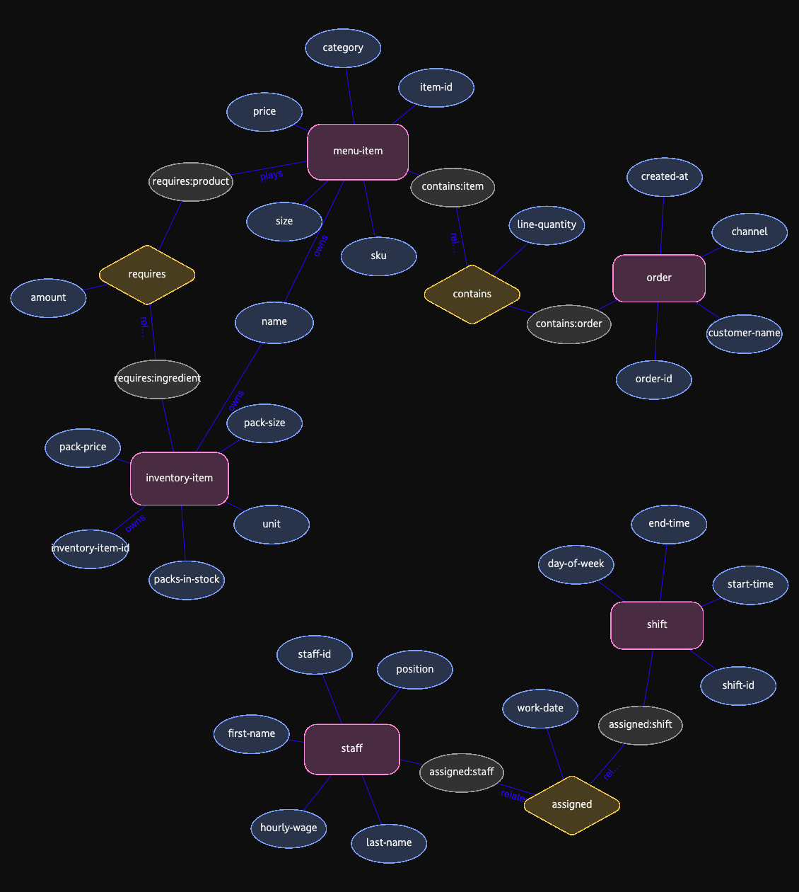

# Coffee-Shop Knowledge Graph (TypeDB 3.x)

A small coffee-shop dataset modeled as a **TypeDB 3.x knowledge graph**. Orders, menu items, inventory, recipes, staff and shift rotas are linked in one graph. That makes it possible to answer business questions that cross several tables in a single query, for example:

- **Stock-out impact:** which menu items, and how much revenue, are at risk from current ingredient stock levels?
- **Demand-driven restocking:** how fast is each ingredient really being used, and when will it run out?
- **Staffing vs. demand:** are the right people rostered when customers actually show up, and does each shift cover its labor cost?

The project is also meant as a reusable template. The `inventory-item → menu-item → order` chain maps directly onto bill-of-materials, formulation, or service-composition data from other domains.



## Repository layout

| Path | Contents |
|---|---|
| `schema.tql` | The TypeDB 3.x schema (entities, relations, attributes) |
| `specs/00-foundation.md` | The approved data model, design principles (D1–D8) and shared conventions |
| `specs/01-stock-out.md` | Scenario spec: stock-out impact tracing |
| `specs/02-restocking.md` | Scenario spec: demand-driven restocking |
| `specs/03-staffing.md` | Scenario spec: staffing vs. demand |
| `functions/` | Schema-level TypeQL functions, one file per scenario spec |
| `queries/` | Scenario queries, one folder per scenario spec |
| `out/` | Generated TypeQL data files, ready to load |
| `scripts/` | Placeholder for data-preparation scripts |

## Data model

**Entities.** Each has an `@key` identity attribute.

| Entity | Key | Attributes |
|---|---|---|
| `inventory-item` | `inventory-item-id` | name, pack-size, unit, pack-price, packs-in-stock |
| `menu-item` | `item-id` | sku, name, category, size, price |
| `order` | `order-id` | created-at, customer-name, channel |
| `staff` | `staff-id` | first-name, last-name, position, hourly-wage |
| `shift` | `shift-id` | day-of-week, start-time, end-time |

**Relations.** A quantity that describes a connection is stored on the relation.

| Relation | Roles | Attribute | Meaning |
|---|---|---|---|
| `requires` | `product: menu-item`, `ingredient: inventory-item` | `amount` | One recipe line: how much of an ingredient one serving uses |
| `contains` | `order: order`, `item: menu-item` | `line-quantity` | One order line |
| `assigned` | `staff: staff`, `shift: shift` | `work-date` | One rota entry: a staff member works a shift on a date |

Key design choices (full rationale in [`specs/00-foundation.md`](specs/00-foundation.md)):

- **No foreign-key attributes.** Every join is a relation.
- **No recipe entity.** A menu item's recipe is the set of its `requires` relations.
- **One `order` per real order.** The source has one row per order *line*; lines become `contains` relations. Repeated lines for the same item in the same order are merged into one relation with a summed `line-quantity`.

## Replicating the project

### 1. Install and start TypeDB

This project targets **TypeDB 3.x** (developed against 3.13.0). Follow the official documentation to install TypeDB and the TypeDB Console, and to start a server instance:

- TypeDB documentation: https://typedb.com/docs/home/

TypeQL syntax and console commands change between 3.x releases, so check the docs for the version you install.

### 2. Create the database and load the schema

Using TypeDB Console (or TypeDB Studio), create a database (e.g. `coffee-shop`), open a **schema** transaction, run the contents of `schema.tql`, and commit.

### 3. Load the data

The generated files in `out/` are ready to load. Open a **write** transaction and load them in this order, entities before relations, because relation files match their role players by key:

| Order | File | Content | Instances |
|---|---|---|---|
| 1 | `out/inventory-item_insert.tql` | `inventory-item` entities | 18 |
| 2 | `out/menu-item_insert.tql` | `menu-item` entities | 24 |
| 3 | `out/orders_insert.tql` | `order` entities | 430 |
| 4 | `out/staff_insert.tql` | `staff` entities | 4 |
| 5 | `out/shift_insert.tql` | `shift` entities | 12 |
| 6 | `out/requires_relations.tql` | `requires` relations | 61 |
| 7 | `out/contains_relations.tql` | `contains` relations | 517 |
| 8 | `out/assigned_relations.tql` | `assigned` relations | 18 |

Entity files are a single `insert`. Relation files hold one `match … insert … end;` query per relation instance, for example:

```typeql
match
  $order isa order, has order-id "ORD001";
  $item isa menu-item, has item-id "It008";
insert
  contains (order: $order, item: $item), has line-quantity 1;
end;
```

Commit, then check the counts against the table above, e.g.:

```typeql
match $o isa order; reduce $count = count;
```

### 4. Run a scenario

**Stock-out impact (spec 01).** Open a **schema** transaction, run
`functions/01-stock-out.tql`, and commit. Then, in a **read** transaction, run:

- `queries/01-stock-out/q1-alert.tql`: items that can make fewer than N more
  servings from current stock (default N = 50), with revenue and the
  limiting ingredient. Change N on the line marked `# <-- N`.
- `queries/01-stock-out/q2-what-if.tql`: the items that become unsellable
  if one ingredient runs out, with the revenue exposed. Change the ingredient
  on the line marked `# <-- ingredient`.

### 5. (Optional) Regenerate the TypeQL from the CSVs

You only need this if you want to change the data or the mapping. The source CSVs are not in this repository.

- Download the dataset from Kaggle: https://www.kaggle.com/datasets/viramatv/coffee-shop-data
- Entity insert files can be generated from per-entity CSVs with [csv2typedb-3.x](https://github.com/rbabaeecar/csv2typedb-3.x), a CSV-to-TypeQL converter driven by a YAML config.
- Relation files are generated from the line-level CSVs (recipes, order lines, rota) with one match-insert per row, as shown above. Before generating them, check that every key resolves to exactly one entity, and merge duplicate (order, item) pairs.

Literal formats used throughout: doubles always have a decimal point (`8.0`), datetimes are written as `2024-02-12T07:04:19`, and dates are unquoted (`2024-02-12`).

## Dataset notes

- The data covers one trading week, 2024-02-12 to 2024-02-17 (Mon–Sat). Orders and the staff rota cover the same week, so staffing and demand can be compared directly.
- The 521 order lines in the source collapse to 517 `contains` relations: 4 orders list the same item on two lines, and each pair is merged into one relation with `line-quantity 2`.
- One inventory item (ING018, vanilla extract) appears in no recipe, so it has no `requires` relation.

## Credits

- Dataset: [Coffee Shop Data](https://www.kaggle.com/datasets/viramatv/coffee-shop-data) on Kaggle.
- Database: [TypeDB](https://typedb.com/).
